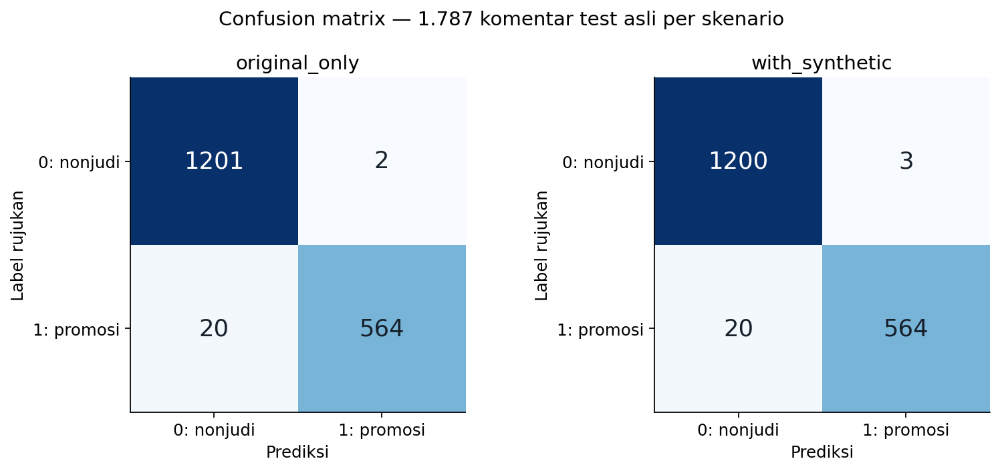

# svm-classifier

Klasifikasi komentar promosi judi online di YouTube menggunakan **TF-IDF dan Support Vector Machine (SVM)**. Dataset, cleaning, komentar sintetis, dan pembagian eksperimen mengikuti pipeline Athar yang dipatok versinya.

Repo ini adalah kontribusi SVM untuk proyek UTS empat orang. Anggota lain mengerjakan ANN dan Naive Bayes; anggota keempat menyusun perbandingan serta paper. Repo ini menyediakan **hasil SVM dan bukti yang dapat diperiksa**, tanpa menjalankan perbandingan lintas-metode.

```text
komentar_processed → TF-IDF → LinearSVC → prediksi → evaluasi
```

## Hasil run yang disertakan

Run: `20261021T140045Z_c5de4779`. Kedua skenario memakai **1.787 komentar test asli yang sama**: 1.203 label `0`, 584 label `1`.

| Skenario SVM | Accuracy | Precision (1) | Recall (1) | F1 (1) | Macro-F1 |
| --- | ---: | ---: | ---: | ---: | ---: |
| Original only | 98,77% | 99,65% | 96,58% | 98,09% | 98,59% |
| With synthetic | 98,71% | 99,47% | 96,58% | 98,00% | 98,53% |

Keduanya dipilih melalui validation dengan TF-IDF karakter `char_wb` 3–5 gram dan `C=10`. Skenario pilihan validation adalah `original_only`. Tambahan sintetis menghasilkan satu false positive tambahan pada run ini; hasil tersebut tidak menunjukkan signifikansi statistik.

Lihat [hasil lengkap](docs/HASIL_SVM.md), [tabel numerik](outputs/runs/20261021T140045Z_c5de4779/test_metrics.csv), dan [catatan verifikasi](outputs/runs/20261021T140045Z_c5de4779/verification.json).

Format notebook dan empat figure sudah diperiksa; inspeksi visual halaman notebook penuh masih terhalang browser sandbox. Lihat rincian status di [LINGKUNGAN.md](docs/LINGKUNGAN.md).



**Status eksekusi:** seluruh 16 sel kode dijalankan berurutan melalui IPython dan pemeriksaan numerik/model lulus. Eksekusi melalui kernel Jupyter belum diverifikasi karena dependensi kernel tidak tersedia dalam sesi offline ini. Versi scientific berbeda dari upstream, termasuk scikit-learn **1.4.2**, dan direkam secara eksplisit di [LINGKUNGAN.md](docs/LINGKUNGAN.md). Tidak ada klaim bahwa run menggunakan scikit-learn 1.8.0.

## Urutan baca untuk teman kelompok

1. [METODE_SVM.md](docs/METODE_SVM.md): alur dan istilah metode.
2. [svm_experiments.ipynb](svm_experiments.ipynb): kode, tabel, dan grafik yang sudah memiliki output.
3. [HASIL_SVM.md](docs/HASIL_SVM.md): parameter terpilih dan pembahasan hasil SVM.
4. [KONTRAK_HASIL.md](docs/KONTRAK_HASIL.md): definisi kolom, identitas dataset, dan berkas yang diserahkan kepada penulis paper.

## Jalankan di Jupyter atau VS Code

Gunakan Python 3.11 dan buka terminal dari root repo:

```powershell
python -m venv .venv
.\.venv\Scripts\Activate.ps1
python -m pip install -r requirements-notebook.txt
```

Sediakan clone upstream. Jika belum ada, clone sekali:

```powershell
git clone https://github.com/atharikputra/JudiScope.git ../JudiScope
```

Impor snapshot. Importer membaca commit yang dipatok, tanpa mengubah checkout upstream:

```powershell
python scripts/import_athar_data.py --source ../JudiScope
python scripts/run_notebook.py
```

Runner kernel memasang kernelspec hanya pada `.venv`, menjalankan notebook dari awal, dan menyimpan output. Alternatif: buka notebook di VS Code/Jupyter, pilih kernel `.venv`, restart kernel, lalu Run All. Notebook tidak membuat split baru.

Jika hanya scientific dependencies tersedia, fallback eksplisit berikut menjalankan kode dan mencatat mode `sequential_ipython`:

```powershell
python -m pip install -r requirements.txt
python scripts/run_notebook.py --sequential
```

Fallback ini tidak mengklaim verifikasi kernel Jupyter. Instalasi scientific run disertakan dapat direproduksi lebih ketat dengan `requirements-executed.txt`.

## Periksa hasil dan buat handoff

```powershell
$svmRun = (Get-Content outputs/latest_run.json -Raw | ConvertFrom-Json).path
python scripts/verify_run.py --run $svmRun
python scripts/package_run.py --run $svmRun
python predict.py --model "$svmRun/models/svm_original_only.joblib" --text "Videonya membantu, terima kasih"
```

Verifikasi menghitung ulang metrik dari prediksi ekspor, memeriksa ID/label/hash teks, keputusan validation, dan kedua model setelah dimuat ulang. `deliverables/svm_<run_id>.zip` membawa snapshot input, kode, notebook, model, prediksi/error, serta manifest hash untuk anggota penulis paper. File rinci/data/model dan ZIP tidak dimasukkan ke Git secara otomatis; reproduksi melalui perintah di atas atau serahkan bundle lokal.

## Dataset dan protokol bersama

- Sumber upstream: [JudiScope](https://github.com/atharikputra/JudiScope), commit `d9c7feb47aeac1f2889e19c2cddc255525e358ef`.
- Sumber awal menurut tim: [Kaggle yaemico/judionline](https://www.kaggle.com/datasets/yaemico/judionline).
- 8.934 asli bersih + 1.066 sintetis; 10.000 gabungan bukan 10.000 komentar YouTube asli.
- Manifest asli: 5.360 train / 1.787 validation / 1.787 test, dicocokkan dengan `source_row`.
- Sintetis masuk fitting saja; pilih konfigurasi melalui validation F1 kelas `1`, lalu macro-F1.
- Final refit: 7.147 asli atau 8.213 termasuk sintetis. Test selalu asli.

Hash dan aturan lengkap ada di [data/README.md](data/README.md) serta [konfigurasi upstream](config/upstream_manifest.json). Arti resmi label, metode anotasi, dan lisensi sumber belum terkonfirmasi. Hasil dibatasi pada split teks unik ini; pola template/video/kampanye yang mirip dapat melintasi split.

## Publikasi repository

Tujuan yang disetujui adalah repository public `aidanismail/svm-classifier`. Setelah commit lokal tersedia dan jaringan GitHub dapat diakses, `./publish.ps1` memeriksa akun, menolak riwayat tujuan yang berbeda, membuat repository bila belum ada, lalu push tanpa force. Script tidak mempublikasikan bundle data/model secara otomatis.
